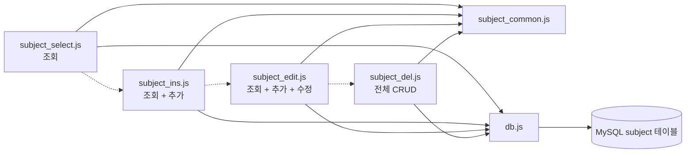
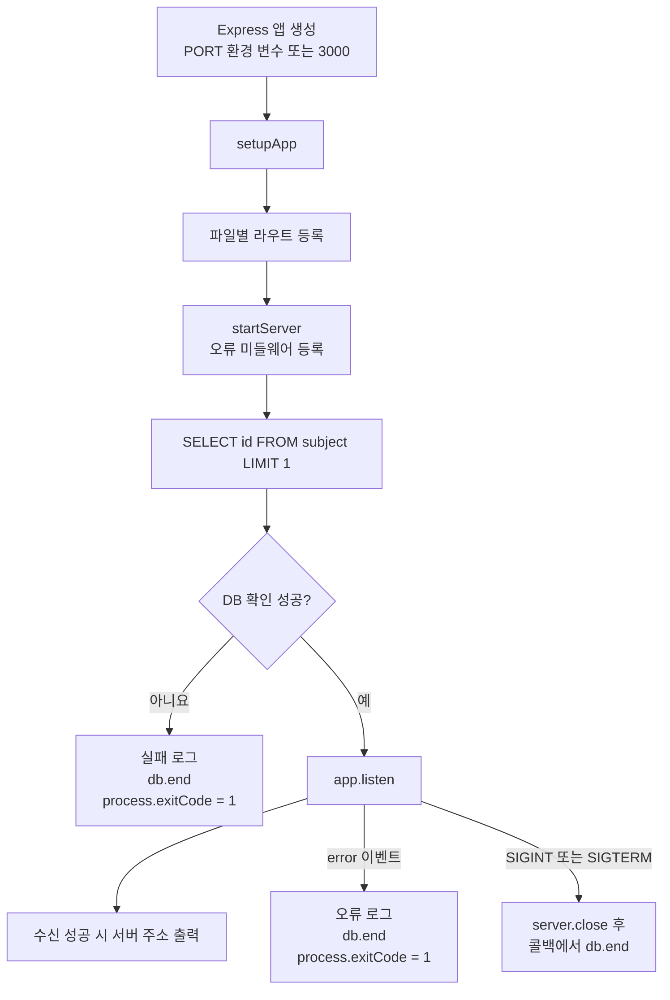
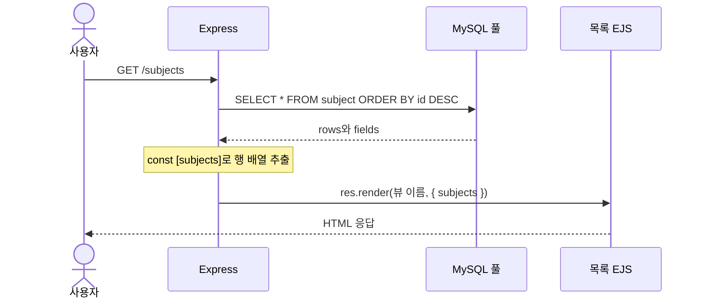
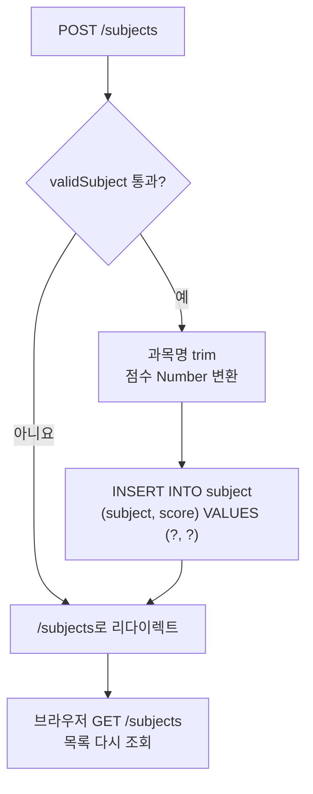
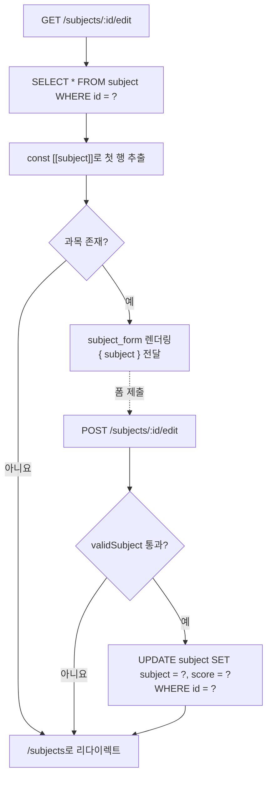
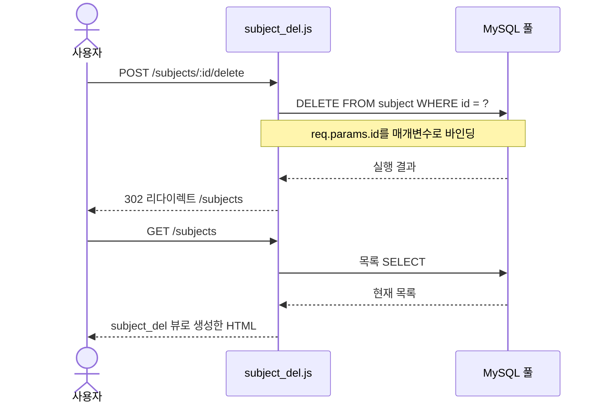
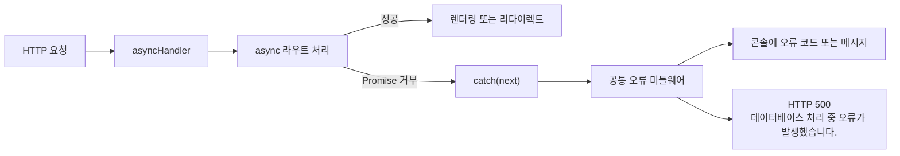

# subject*.js Mermaid 설명서

## 파일 구성

각 파일은 독립적인 Express 서버다. 점선은 학습 순서이며 파일 사이의 import 관계는 아니다.

| 파일 | 역할 |
|---|---|
| subject_select.js | GET /subjects로 목록 조회, subject_select 뷰 렌더링 |
| subject_ins.js | 목록 조회와 POST /subjects 추가, subject_ins 뷰 사용 |
| subject_edit.js | 조회·추가·수정, subject_edit 목록 뷰와 subject_form 수정 뷰 사용 |
| subject_del.js | 조회·추가·수정·삭제, subject_del 목록 뷰와 subject_form 수정 뷰 사용 |
| subject_common.js | asyncHandler, validSubject, setupApp, startServer 제공 |

## 공통 초기화와 종료

setupApp은 EJS와 views 경로를 설정하고 URL 인코딩 폼 본문 파서를 등록한다. GET / 요청은 /subjects로 이동한다.

시작 쿼리는 DB 연결과 테이블의 id 조회 가능 여부를 확인한다. 테이블에 행이 없어도 성공한다.

## 조회 흐름

모든 실행 파일은 같은 SQL을 사용하며, 파일별 목록 EJS에 subjects 배열을 전달한다.

id 내림차순으로 정렬하므로 더 큰 ID의 과목이 먼저 나타난다.

## 추가 흐름과 검증

subject_ins.js, subject_edit.js, subject_del.js에서 제공한다.

validSubject는 다음 조건을 모두 검사한다.

- 과목명은 문자열이며 trim 후 길이가 1~100자다.
- 점수 원본은 문자열이며 공백만 있는 값이 아니다.
- Number로 변환한 점수는 0~100 범위의 정수다.

검증 실패 시 오류 메시지 없이 목록으로 이동한다. SQL의 물음표에는 변환한 값을 매개변수로 전달한다.

## 수정 흐름

subject_edit.js와 subject_del.js는 수정 화면 요청과 저장 요청을 구분한다.

조회 ID는 req.params.id다. 수정에서는 trim한 과목명, Number로 변환한 점수, ID 순으로 값을 바인딩한다. UPDATE 결과의 영향받은 행 수는 확인하지 않으므로 대상 ID가 없어도 SQL 오류가 없으면 목록으로 이동한다.

## 삭제 흐름

subject_del.js에만 삭제 라우트가 있다. 파일 이름과 달리 조회·추가·수정도 모두 포함한 완성본이다.

삭제는 validSubject를 호출하지 않으며 영향받은 행 수도 확인하지 않는다.

## 비동기 오류 처리

모든 CRUD 라우트는 asyncHandler로 감싼다. 반환된 Promise가 거부되면 catch(next)가 공통 오류 미들웨어로 전달한다.

입력 검증 실패는 리다이렉트 경로다. 서버 시작 전 DB 확인 실패는 startServer 내부 try/catch가 별도로 처리한다.

## 실행 방법과 DB 준비

1. npm install로 의존성을 설치한다.
2. db.js의 접속 설정과 subject_schema.sql의 데이터베이스 이름을 맞추고 스키마를 실행한다.
3. 아래 명령 중 하나를 실행하고 http://localhost:3000/subjects 에 접속한다.

현재 db.js는 testdb를 사용하지만 subject_schema.sql은 todo_app을 생성·선택한다. 같은 데이터베이스를 사용하도록 맞춰야 한다.

| 명령 | 실행 파일 |
|---|---|
| npm run subject:select | subject_select.js |
| npm run subject:insert | subject_ins.js |
| npm run subject:edit | subject_edit.js |
| npm run subject:delete 또는 npm run subject:crud | subject_del.js |

기본 포트가 같으므로 다음 단계로 넘어갈 때 Ctrl+C로 기존 서버를 종료한다. PORT 환경 변수로 포트를 바꿀 수도 있다.

테이블 컬럼은 id(INT 자동 증가 기본 키), subject(VARCHAR 100, NOT NULL), score(INT, NOT NULL)다. 제공된 스키마에는 점수 범위 CHECK 제약이 없으며, 0~100 검증은 JavaScript에서 수행한다.